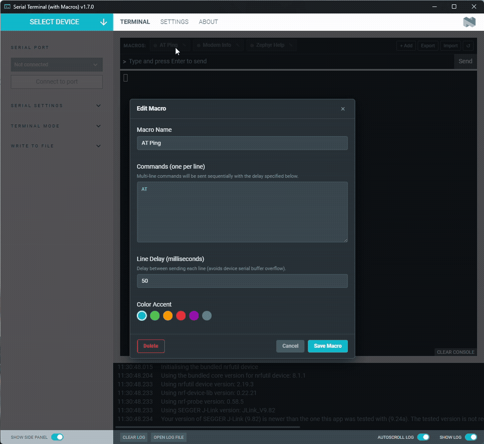

# Serial Terminal app

[](LICENSE)

The Serial Terminal app allows you to connect to serial devices.

> **Macro Buttons Edition:** This fork adds customizable macro buttons for
> sending pre-configured multi-line serial command blocks with configurable line
> delays, color tags, and JSON import/export!



## Macro Buttons Features

- **Customizable Buttons:** Define name, color accents, and command payloads.
- **Sequential Execution with Delay:** Configurable line delay (in ms) to
  prevent serial buffer overrun on microcontrollers.
- **Edit & Delete:** Click the edit icon (`✎`) or right-click any macro.
- **Import / Export JSON:** Share macro presets with teammates.
- **Abort / Stop:** Cancel execution of long-running multi-line macros easily.

## Installation

### Via nRF Connect Source JSON (Recommended)

1. Open **nRF Connect for Desktop**.
1. Click the **Settings (gear icon)**.
1. In the **Apps** or **Sources** section, add the following Source URL:
    ```text
    https://raw.githubusercontent.com/phs333/pc-nrfconnect-serial-terminal/main/source.json
    ```
1. Click **Add source**.
1. On the main apps list, locate **Serial Terminal (with Macros)** and click
   **Install** (or **Open**).

### Manual / Local Folder Installation

1. Copy or extract the app folder into:
    - **Windows:**
      `%USERPROFILE%\.nrfconnect-apps\local\pc-nrfconnect-serial-terminal`
    - **Linux / macOS:**
      `~/.nrfconnect-apps/local/pc-nrfconnect-serial-terminal`
1. Restart **nRF Connect for Desktop**.

### Official App

The official Serial Terminal app can also be installed from nRF Connect. For
detailed steps, see
[Installing nRF Connect for Desktop apps](https://docs.nordicsemi.com/bundle/swtools_docs/page/app/nrf-connect-desktop/installing_apps.html)
in the nRF Connect from Desktop documentation.

## Documentation

Read the
[Serial Terminal app](https://docs.nordicsemi.com/bundle/swtools_docs/page/app/pc-nrfconnect-serial-terminal/index.html)
official documentation.

## Development

See the [app development](https://nordicsemi.github.io/pc-nrfconnect-docs/)
pages for details on how to develop apps for the nRF Connect for Desktop
framework.

## Feedback

Please report issues on the [DevZone](https://devzone.nordicsemi.com) portal.

## Contributing

See the
[information on contributing](https://nordicsemi.github.io/pc-nrfconnect-docs/contributing)
for details.

## License

See the [LICENSE](LICENSE) file for details.
